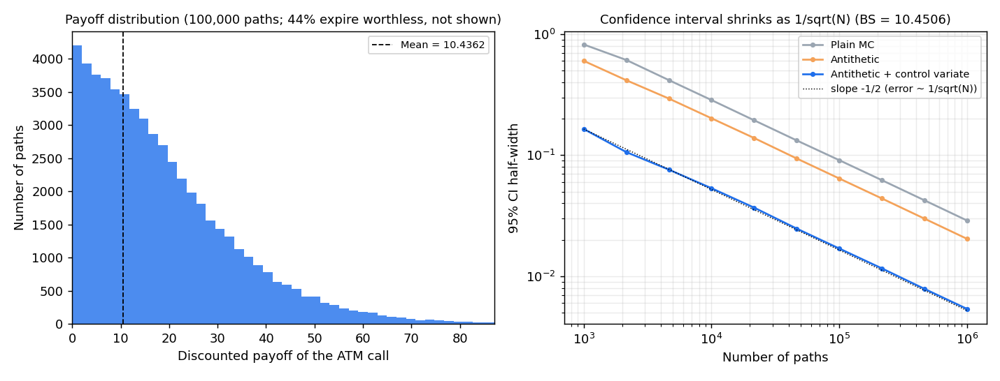
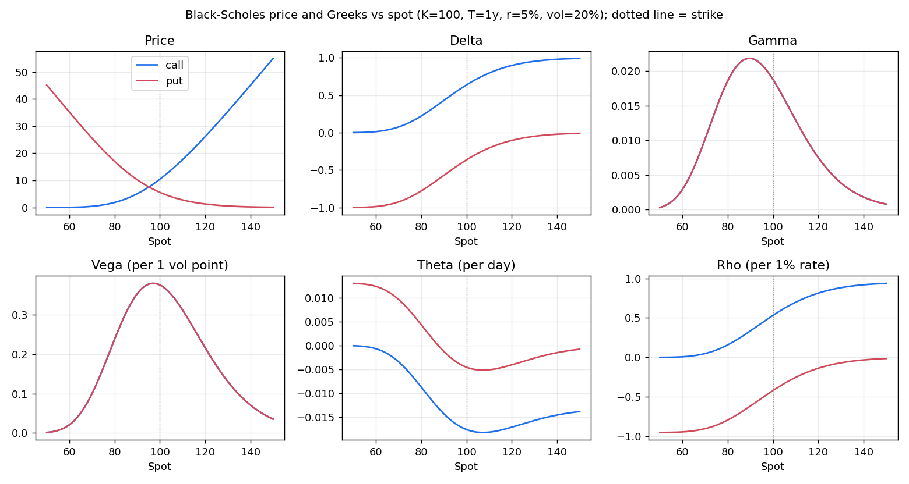

# option-pricer

> **En bref (FR)** : petit pricer d'options vanilles en Python : Black-Scholes et grecques, volatilité
> implicite, Monte Carlo avec réduction de variance et intervalle de confiance à 95 %, options américaines
> par arbre binomial et par Longstaff-Schwartz. Testé avec pytest, avec un notebook commenté et un
> classeur Excel sans macro. Projet personnel d'apprentissage et de démonstration, pas un outil de production.

A small, tested Python toolkit for pricing vanilla equity options, with a walkthrough notebook and a
macro-free Excel version.

## Figures

All figures are produced by `python examples/make_figures.py` (fixed seeds, so they are reproducible).


*Left: Monte Carlo price and 95% interval vs number of paths, plain vs antithetic + control variate. Right: CRR tree error vs number of steps (odd/even oscillation).*


*Left: distribution of discounted payoffs of the ATM call. Right: the 95% interval shrinks as 1/sqrt(N); each variance reduction technique shifts the line down.*


*Black-Scholes price and the five Greeks of a call and a put as functions of the spot.*


*Left: European put price across spot and maturity. Right: American put (CRR) vs European put: the gap is the early exercise premium.*

## What is inside

| Module | Content |
|---|---|
| `black_scholes.py` | Black-Scholes-Merton price for European calls/puts with a continuous dividend yield; analytical delta, gamma, vega, theta, rho |
| `implied_vol.py` | Implied volatility: Newton-Raphson on vega, bisection fallback; rejects prices outside no-arbitrage bounds |
| `monte_carlo.py` | European Monte Carlo under GBM with antithetic variates and a control variate; price, standard error, 95% CI |
| `binomial.py` | Cox-Ross-Rubinstein tree, European or American exercise |
| `lsm.py` | Longstaff-Schwartz least-squares Monte Carlo for American options |
| `notebooks/walkthrough.ipynb` | Every method run on one example, with outputs and charts |
| `excel/option_pricer.xlsx` | Price and Greeks in native Excel formulas, chart of price vs spot, Monte Carlo sheet |
| `vba/BlackScholes.bas` | Optional VBA module adding `=BS_PRICE(...)` and `=BS_GREEK(...)` worksheet functions |

## Quick start

Requires Python 3.9+.

```bash
git clone https://github.com/pavass06/option-pricer.git
cd option-pricer
python3 -m venv .venv && source .venv/bin/activate
pip install -r requirements.txt

python examples/quickstart.py      # prints prices, Greeks, implied vol, MC and American put
pytest                             # runs the test suite
python examples/make_figures.py    # regenerates docs/*.png
python excel/build_workbook.py     # regenerates excel/option_pricer.xlsx
```

Conventions: `T` in years, rates and volatility as decimals, continuous compounding. In Python, vega and rho are
per 1.00 change and theta is per year; the Excel sheet and VBA functions show them per 1 percentage point and per
calendar day.

All numbers below come from running the code. Example: S = K = 100, T = 1 year, r = 5%, volatility 20%.

## 1. Black-Scholes and Greeks

Closed-form price of a European option and its analytical sensitivities. Every Greek is tested against a
central finite difference.

```python
from option_pricer import bs_greeks

bs_greeks(100, 100, 1.0, 0.05, 0.20, "call")
# Greeks(price=10.4506, delta=0.6368, gamma=0.0188, vega=37.52, theta=-6.414, rho=53.23)
bs_greeks(100, 100, 1.0, 0.05, 0.20, "put")
# Greeks(price=5.5735, delta=-0.3632, gamma=0.0188, vega=37.52, theta=-1.658, rho=-41.89)
```

Put-call parity holds: C − P = 4.877058 = S − K·e^(−rT).

## 2. Implied volatility

Finds the volatility that reproduces a market price. Newton-Raphson converges in a few steps near the money;
when a step leaves the bracket or vega is close to zero (deep in or out of the money), the solver switches to
bisection, which always converges.

```python
from option_pricer import bs_price, implied_vol

implied_vol(10.4506, 100, 100, 1.0, 0.05, "call")                 # 0.200000
price = bs_price(100, 60, 1.0, 0.05, 0.35, "put")                 # deep out-of-the-money put
implied_vol(price, 100, 60, 1.0, 0.05, "put")                     # 0.350000
```

On a 17-strike smile (strikes 60 to 140), the round-trip error is below 1e-10 (see the notebook).

## 3. Monte Carlo with variance reduction

The terminal spot is sampled exactly under geometric Brownian motion (no discretisation error). Two variance
reduction techniques, both on by default:

- **antithetic variates**: each normal draw Z is paired with −Z, and the estimator averages each pair;
- **control variate**: the discounted terminal spot, whose expectation S·e^(−qT) is known exactly, corrects
  the payoff estimator (optimal coefficient estimated by regression).

The result carries a standard error and a 95% confidence interval.

```python
from option_pricer import mc_price

mc_price(100, 100, 1.0, 0.05, 0.20, "call", n_paths=100_000,
         antithetic=False, control_variate=False, seed=0)
# 10.4362 +/- 0.0912 (95% CI [10.3450, 10.5273])   std error 0.0465
mc_price(100, 100, 1.0, 0.05, 0.20, "call", n_paths=100_000, seed=0)
# 10.4577 +/- 0.0172 (95% CI [10.4405, 10.4750])   std error 0.0088
# Black-Scholes: 10.4506
```

Same number of draws, standard error about 5 times smaller (25 times fewer paths needed for the same
precision). Over 200 independent runs of 20,000 paths, the 95% interval contained the Black-Scholes price
95.5% of the time.

## 4. American options: binomial tree and Longstaff-Schwartz

An American put can be exercised before maturity, so it is worth at least as much as the European put.

- **CRR binomial tree**: backward induction on a recombining tree, exercise checked at every node.
- **Longstaff-Schwartz (LSM)**: simulated paths; at each exercise date, the continuation value is estimated by
  regressing discounted future cash flows on a cubic polynomial of the spot (in-the-money paths only).

```python
from option_pricer import crr_price, lsm_price

crr_price(100, 100, 1.0, 0.05, 0.20, "put", steps=1000, american=True)   # 6.0896 (European: 5.5735)
lsm_price(100, 100, 1.0, 0.05, 0.20, "put", n_paths=100_000, steps=50, seed=0)
# 6.0974 +/- 0.0265 (95% CI [6.0709, 6.1239])
```

**Benchmark: Longstaff & Schwartz (2001), Table 1** (S = 36, K = 40, r = 6%, vol = 20%, T = 1):

| Method | Price |
|---|---|
| European put, Black-Scholes | 3.8443 (paper: 3.844) |
| American put, CRR tree, 1,000 / 5,000 / 20,000 steps | 4.4868 / 4.4867 / 4.4867 |
| American put, LSM here, 100,000 paths, 50 dates | 4.4751, standard error 0.0060 |
| Paper: finite differences | 4.478 |
| Paper: LSM simulation | 4.472, standard error 0.010 |

About the gap between 4.4867 and 4.478: the tree no longer moves after 1,000 steps, so 4.4867 is the converged
value of the model. The paper's 4.478 comes from a
coarser finite-difference grid. It is not a Monte Carlo error on our side, since the tree has none. The LSM
estimates (ours and the paper's) are lower for two reasons: Monte Carlo noise (the standard errors above) and a
small downward bias, because the exercise rule is estimated from a regression and is therefore slightly
sub-optimal.

## Notebook

`notebooks/walkthrough.ipynb` runs the four sections above with their charts, outputs included, so it can be
read directly on GitHub. To re-run it: `pip install jupyter` then `jupyter notebook notebooks/walkthrough.ipynb`.

## Excel version

Open `excel/option_pricer.xlsx`:

- **Pricer**: edit the yellow cells (spot, strike, maturity, rate, volatility, dividend yield, Call/Put). Price
  and Greeks are plain formulas using named ranges (`Spot`, `Strike`, `Vol`, ...) and only long-standing functions
  (`NORMSDIST`, `LN`, `EXP`), so they can be audited cell by cell. Formulas checked against the Python Greeks
  to 1e-10.
- **Monte Carlo**: convergence table (plain vs antithetic + control variate, with 95% bounds) and a native line
  chart, plus the American put benchmark above. These values are precomputed in Python: they do not follow the
  yellow cells, and are refreshed by `python excel/build_workbook.py`.
- **Chart data**, **Notes**: data behind the price chart, conventions.

No macro. The VBA module is optional: in Excel, `Alt+F11` > File > Import File > `vba/BlackScholes.bas`, then
save as `.xlsm`.

## Tests

`pytest` runs 53 cases (47 pass, 6 skipped by design), in about 2 seconds:

- reference values: Hull (S=42, K=40, r=10%, σ=20%, T=0.5: call 4.7594, put 0.8086), Haug (call 2.1334),
  Longstaff-Schwartz American put (see above);
- put-call parity with and without dividends;
- every analytical Greek against central finite differences;
- implied vol round trip over strikes 50-200, vols 5%-80%, calls and puts (the 6 skipped cases are deep
  in/out of the money at 5% vol, where vega is ~0 and the vol is not identifiable from the price);
- Monte Carlo 95% CI contains the Black-Scholes price; each variance reduction technique lowers the standard
  error; antithetic pairs stay aligned when the number of paths is odd;
- CRR converges to Black-Scholes, American put ≥ European put and ≥ intrinsic, American call without dividend =
  European call;
- LSM matches the tree within 3 standard errors plus a small bias allowance, on three cases.

## Limitations

- Black-Scholes world only: constant volatility and rates, no smile, no stochastic vol, no jumps.
- Vanilla payoffs only; no barriers, Asians or other exotics.
- The CRR tree oscillates with the number of steps (visible in the figure); no smoothing or Richardson
  extrapolation is applied.
- LSM uses the same paths to fit the exercise rule and to price (no separate out-of-sample run), with a fixed
  cubic basis.
- Discrete dividends are not supported (continuous yield only).
- Monte Carlo is vectorised NumPy, not optimised for speed; 95% intervals miss the true value about 1 time in 20.
- Written for learning and demonstration. Not validated for trading or risk use.

## License

MIT, see [LICENSE](LICENSE).
