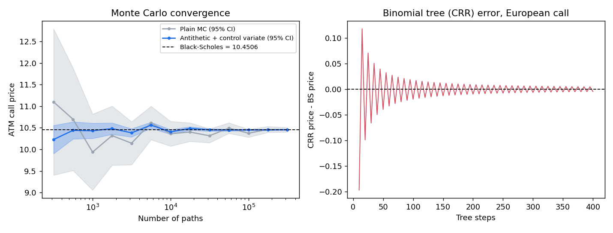
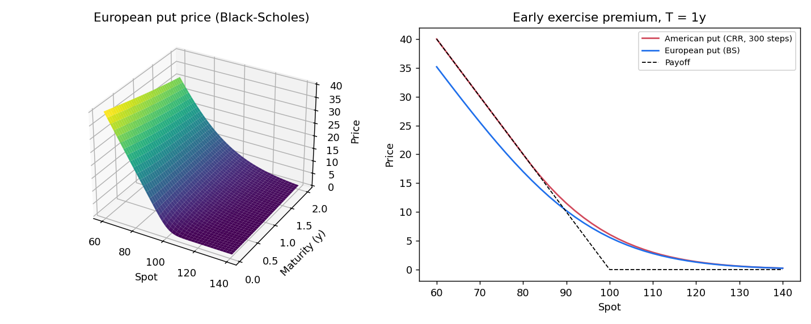

# option-pricer

> **En bref (FR)** : petit pricer d'options vanilles en Python (Black-Scholes et grecques, volatilité
> implicite, Monte Carlo avec réduction de variance, arbre binomial pour les options américaines),
> testé avec pytest, plus un classeur Excel sans macro qui calcule le prix et les grecques en formules
> natives. Projet personnel d'apprentissage et de démonstration, pas un outil de production.

A small, tested Python toolkit for pricing vanilla equity options, with a macro-free Excel version.



## What it does

| Module | Content |
|---|---|
| `black_scholes.py` | Black-Scholes-Merton price for European calls/puts with a continuous dividend yield; analytical delta, gamma, vega, theta, rho |
| `implied_vol.py` | Implied volatility: Newton-Raphson on vega, falls back to bisection when Newton leaves the bracket or vega is tiny; rejects prices outside no-arbitrage bounds |
| `monte_carlo.py` | Monte Carlo under GBM with antithetic variates and a control variate (discounted terminal spot), returns price, standard error and 95% confidence interval |
| `binomial.py` | Cox-Ross-Rubinstein tree, European or American exercise |
| `excel/option_pricer.xlsx` | Price and Greeks in native Excel formulas, Call/Put drop-down, chart of price vs spot and payoff |
| `vba/BlackScholes.bas` | Optional VBA module adding `=BS_PRICE(...)` and `=BS_GREEK(...)` worksheet functions |



## Quick start

Requires Python 3.9+.

```bash
git clone https://github.com/pavass06/option-pricer.git
cd option-pricer
python3 -m venv .venv && source .venv/bin/activate
pip install -r requirements.txt

python examples/quickstart.py      # prints prices, Greeks, implied vol, MC and American put
pytest                             # runs the test suite
python examples/make_figures.py    # regenerates docs/*.png
python excel/build_workbook.py     # regenerates excel/option_pricer.xlsx
```

```python
from option_pricer import bs_greeks, implied_vol, mc_price, crr_price

bs_greeks(100, 100, 1.0, 0.05, 0.20, "call")
# Greeks(price=10.4506, delta=0.6368, gamma=0.0188, vega=37.52, theta=-6.414, rho=53.23)

implied_vol(10.4506, 100, 100, 1.0, 0.05, "call")                     # 0.2000
mc_price(100, 100, 1.0, 0.05, 0.20, "call", n_paths=100_000, seed=0)  # 10.4577 +/- 0.0172 (95% CI half-width)
crr_price(100, 100, 1.0, 0.05, 0.20, "put", steps=1000, american=True) # 6.0896 (European: 5.5735)
```

Conventions: `T` in years, rates and volatility as decimals, continuous compounding. In Python, vega and rho are
per 1.00 change and theta is per year; the Excel sheet and VBA functions show them per 1 percentage point and per
calendar day.

## Excel version

Open `excel/option_pricer.xlsx`, edit the yellow cells (spot, strike, maturity, rate, volatility, dividend
yield, Call/Put). Price and Greeks are plain formulas using named ranges (`Spot`, `Strike`, `Vol`, ...) and only
long-standing functions (`NORMSDIST`, `LN`, `EXP`), so they can be audited cell by cell. The workbook is generated
by `excel/build_workbook.py` (openpyxl); its formulas were checked against the Python Greeks to 1e-10.

The VBA module is optional: in Excel, `Alt+F11` > File > Import File > `vba/BlackScholes.bas`, then save as `.xlsm`.

## Tests

`pytest` runs 48 cases (42 pass, 6 skipped by design), in about 2 seconds:

- reference values: Hull (S=42, K=40, r=10%, σ=20%, T=0.5: call 4.7594, put 0.8086), Haug (call 2.1334),
  Longstaff-Schwartz American put (S=36, K=40: European 3.844, American ≈ 4.487 on a 2000-step tree);
- put-call parity with and without dividends;
- every analytical Greek against central finite differences;
- implied vol round trip over strikes 50-200, vols 5%-80%, calls and puts (the 6 skipped cases are deep
  in/out of the money at 5% vol, where vega is ~0 and the vol is not identifiable from the price);
- Monte Carlo 95% CI contains the Black-Scholes price; each variance reduction technique lowers the standard error;
- CRR converges to Black-Scholes, American put ≥ European put and ≥ intrinsic, American call without dividend = European call.

On the ATM example above, with 100,000 paths the standard error drops from 0.046 (plain MC) to about 0.009 with
antithetic variates plus control variate.

## Limitations

- Black-Scholes world only: constant volatility and rates, no smile, no stochastic vol, no jumps.
- Vanilla payoffs only; no barriers, Asians or other exotics.
- The CRR tree oscillates with the number of steps (visible in the figure); no smoothing or Richardson
  extrapolation is applied.
- Discrete dividends are not supported (continuous yield only).
- Monte Carlo is vectorised NumPy, not optimised for speed; 95% intervals miss the true value about 1 time in 20,
  which also shows in the convergence figure.
- Written for learning and demonstration. Not validated for trading or risk use.

## License

MIT, see [LICENSE](LICENSE).
